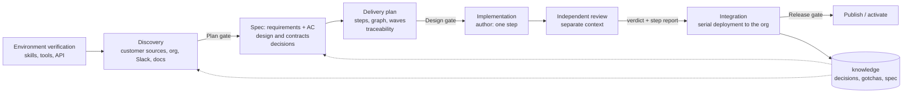
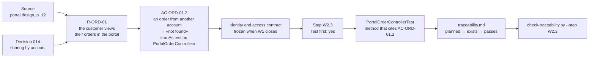
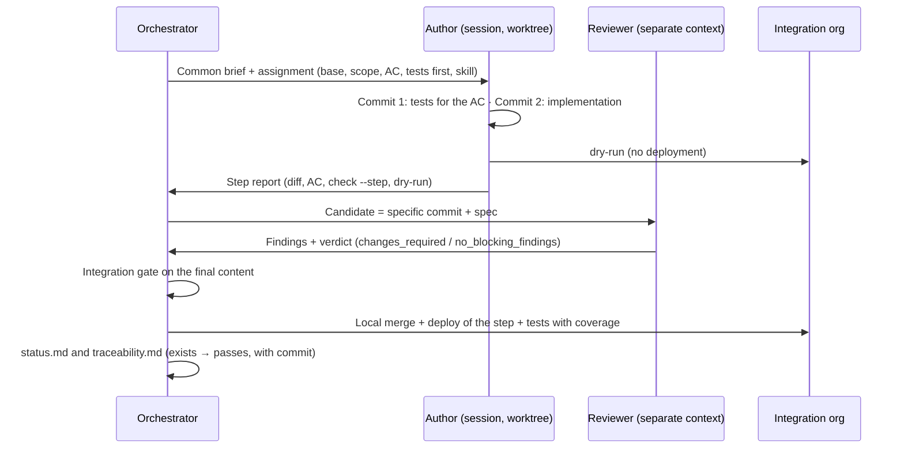

# Spec-driven development with agents on Salesforce

> A guide to the method that the `sdd-salesforce` plugin sets up. It came out of a real POC for a customer, with a
> design hundreds of pages long, a single demo org with an expiry date and a team made up of one person and Claude
> sessions. The examples in this guide belong to a fictitious customer, **ACME**.

Each section opens with its **key message**, so the guide can double as a slide script.

---

## 0. Summary

**Key message:** the spec is the contract. Agents build against requirements with verifiable acceptance criteria, a
script checks the traceability, another agent reviews with a separate context, and the knowledge stays in the repo,
not in anyone's head.

**Four principles:**
1. **The spec is the contract:** requirements with verifiable acceptance criteria (AC), before designing or building.
2. **Every AC has its test,** and a script checks the traceability instead of an eyeball review.
3. **Whoever reviews is not whoever writes:** a separate context and a verdict on a specific commit.
4. **The why lives in the repo:** decisions verified against skills and official documentation, and the status in
   files.

---

## 1. When to use it

**Key message:** in any project where improvising is expensive; the ceremony scales with the size.

Every project is worked the same way: an orchestrator hands out the steps to author sessions, each on its own branch,
and sessions or subagents with a separate context review them. Within each project, every change has a **level of
ceremony** (rule E, §3.2): a wording tweak is not treated like a change of permissions.

---

## 2. Project structure

**Key message:** the project is an SFDX folder with its own git. Inside it live the knowledge (the why) and the
operation (the plan and the status).

### 2.1 What the bootstrap generates (`sdd-bootstrap`)

```
<project>/
├── CLAUDE.md                 ← short: org, approver, autonomy, channels, confidentiality and reading order
├── sdd.config.json           ← org, areas, autonomy, document language and adopted method version
├── knowledge/                ← THE WHY (outlasts the code)
│   ├── discovery/            ← AS-IS: customer sources, org, documentation, Slack
│   ├── specs/                ← requirements with AC, and design
│   ├── decisions/            ← decisions with status and author; 001 is the adoption of the method
│   └── gotchas/              ← traps already paid for
├── docs/
│   ├── delivery-plan/        ← THE OPERATION: plan, traceability, status, handover, questions
│   ├── baseline/             ← org snapshot and environment inventory
│   └── client/               ← customer sources: CONFIDENTIAL, outside git
├── reviews/                  ← independent review reports, per change and per round
└── force-app/ · …
```

**What is not copied:** the method's rules, the orchestrator template, the authors' brief, the communication protocol
and the scripts live in the plugin (skill `sdd-method`). At the start of every session (or at its first message, if
the project was bootstrapped in it), a plugin hook injects the method's core and the project's data; that way every
POC uses the same rules and they all improve together.

### 2.2 What lives where

| Question | Where it is answered |
|---|---|
| What does the system have to do, and how do I know it does it? | Spec, Part 1 (requirements and AC) |
| How is it designed? | Spec, Part 2 (contracts, architecture, tests); Agent Spec if there is an agent |
| Why was X chosen over Y? | `knowledge/decisions/`, with "Alternatives considered" and "Verified with" |
| What traps are there? | `knowledge/gotchas/` |
| Do I have the skills and tools I need? | `docs/baseline/environment-<date>.md` |
| What gets built, in what order and by whom? | `docs/delivery-plan/README.md`, `implementation/` and `integration.md` |
| Which step satisfies each AC, and with what test? | `traceability.md`, validated by `check-traceability.py` |
| Where are we? | `status.md`, the **single source** of status |
| What is still to be decided or validated? | `questions.md` |
| How do I pick the work up cold? | `handover.md` and the orchestrator template in `sdd-method` |
| What changes are in progress after the Design gate? | The "Change queue" in `status.md` and the "Change log" in the spec |

### 2.3 Reading order for any session

The method's core (injected by the plugin) → `CLAUDE.md` → `handover.md` → `status.md` → `Active` decisions, gotchas
and specs for the scope → delivery plan. Every file in `knowledge/` has frontmatter, so an agent chooses what to read
with `ls` and the headers, without loading whole documents.

### 2.4 Structural rules

- **Local git,** with the baseline tagged when the Plan gate is approved. Each step on its own branch.
- **Confidentiality:** `docs/client/` is not versioned; in the org and in `data/`, synthetic data only.
- **A single writer** for `status.md`: the main session.
- **One folder per customer:** `read-knowledge` never reads sibling folders.

---

## 3. Methodology: spec-driven development on Salesforce

**Key message:** first the what, with checkable acceptance criteria; then the how. Every AC has a named verification,
and a machine checks that there are no gaps.

### 3.1 The cycle and the 4 gates



| Gate | What is approved |
|---|---|
| **Plan** | The environment inventory (no gaps, or gaps accepted) and the discovery |
| **Design** | The spec, the decisions and the delivery plan, after their independent review |
| **Each Execution step** | The reviewer's verdict and the step report; with `strict` autonomy, the human OK as well |
| **Release** | `publish` and `activate`: always an explicit human OK |

### 3.2 The rules (rule M-06 of the method)

| Rule | What it means |
|---|---|
| **A · Requirements and AC first** | `R-<AREA>-NN`, with source, priority and at least one `AC-<AREA>-NN.M`: "Given…, when…, then… (where it is checked)". The AC cover errors, rejections and denied permissions. No contract moves to `Ready` without AC |
| **B · The what separated from the how** | The spec has two parts, requirements and design. The order goes in the plan and the progress in the status: the spec has no checkboxes |
| **C · Checkable traceability** | Every AC names its verification, and `check-traceability.py` checks that there are no gaps |
| **D · Test first, within limits** | At level 3 and in Apex and agent logic, the test goes in a commit **before** the implementation |
| **E · Levels of ceremony** | 0 · bug (regression test; the spec does not change); 1 · tweak (the step carries its AC); 2 · feature (spec, test first, one reviewer); 3 · contract or risk (full spec, design and plan, a second security perspective). When in doubt, the higher one |

### 3.3 Anatomy of the spec

- **Part 1 · Requirements:** Why, What, exclusions, actors and the catalogue of requirements by area. Open items go
  inline: `[PENDING: Q-NN]`.
- **Part 2 · Design:** preconditions, architecture and source of truth, and the **contracts** that unblock parallel
  work (data model, states and transitions, integrations, identity and access). Then the applicable aspects and the
  test strategy.
- **A separate Agent Spec,** with the ADLC template (`agentforce-generate`) and functional and security tests with
  `sf agent test`.

### 3.4 One AC end to end (ACME example)



1. The requirement cites its source (document and page) and the decisions that shape it.
2. The AC says **where it is checked**: an Apex test, a `sf agent test` case, an allowed/denied test with `runAs`, a
   record in the org or a demo step.
3. The plan step declares which AC it satisfies, which test is written first, when it is done and with which
   **skill** it is built.
4. The test cites the AC ID in the method name or in a comment (`// AC-ORD-01.2`).
5. The check fails if an AC has no row, if a row points to a step that does not exist, if the graph has cycles, if a
   step's skill is not installed or, with `--step`, if an AC of the step has no test.

### 3.5 Decisions as a record

- One decision per file, with context, decision, alternatives, consequences and **"Verified with"**.
- **`author`:** whoever decided (a name, `agent` or `Name + agent`). The agent's decisions stay in plain sight.
- **They are never rewritten:** a new one supersedes the earlier one and the two are linked. `Proposed` ones wait for
  an OK.
- **"Verified with" (rule M-05):** every technical decision and every AC is checked against the area's Salesforce
  skills and the official documentation (`platform-docs-get`), not only against the customer's design. If something
  is not documented, it becomes a validation in the org before building.

### 3.6 How each kind of piece is verified

| Piece | Verification |
|---|---|
| Apex (services, triggers, sharing) | Apex tests with `--code-coverage`, including allowed/denied tests with `runAs` |
| Agent (Agent Script) | `sf agent validate`, `sf agent test` cases (functional and security) and a preview with live actions |
| Autolaunched and record-triggered Flows | Flow tests (Test Mode) or an Apex test that fires the flow |
| Screen Flows and OmniScripts | Apex for their logic, the test case written first and a demo step |
| LWC | Jest |
| Metadata (objects, fields, CMDT) | `deploy --dry-run` and a describe or a checking SOQL query |
| Whatever the documentation does not guarantee | A spike in the org, as a prior validation |

### 3.7 What Salesforce forces you to adapt

1. **The org is the integration base and cannot be forked:** branches work locally, and the composition is tested in
   the org, deploying serially.
2. **There are changes outside the code** (Setup, permissions that Support enables, recipes): they are recorded as
   evidence and, if they are metadata, brought back with a retrieve.
3. **There is no useful source tracking:** the candidate is identified by commit and diff, not by the state of the org.
4. **Publishing has its own steps:** in OmniStudio, Data Mapper → Integration Procedure → OmniScript → activate; the
   LWR site has to be republished; for the agent, `publish` does not activate.
5. **There are irreversible settings:** each one needs its own decision and the explicit OK.
6. **Demo orgs expire:** the plan is made against that date.

### 3.8 After the Design gate: change requests

**Key message:** the approved spec keeps describing the system after every change, without running the full cycle for
each one (rule M-09).

- **Queue:** every change, wherever it comes from, enters the "Change queue" in `status.md` with its `CH-NNN`.
- **Triage:** does the code break an AC, or does the change alter what the spec promises? **0 · bug** (regression
  test; the spec does not change), **1 · tweak**, **2 · feature** (the delta is approved before the code: by the
  orchestrator or, if escalated, by the approver), **3 · contract or risk** (it goes through the Design gate again).
  When in doubt, the higher level; escalation to the approver is a separate matter.
- **One change, one session:** it starts from the files, not from the orchestrator's conversation. The orchestrator
  integrates, does not review its own changes, and is rotated with a handover at every phase change or when its
  conversation has been compacted.
- **The delta before the code:** if a requirement or an AC changes, its row in the "Change log" (at the end of the
  spec) goes in before or in the same commit. `check-traceability.py` reports an error if an ID changed since the
  last tag (`release-N` or `design-approved`) without its row.
- **Each release, a `release-N` tag:** the following deltas are counted from it.

---

## 4. Environment verification

**Key message:** before investigating anything, Claude checks that it has the tools to do it properly.

- **What is checked:**
  - the base skills, in any project: official documentation, metadata, deploy, SOQL, Apex and its tests, permissions,
    org management and Code Analyzer;
  - the skills for the project's **areas** (Agentforce, Flow, LWC, LWR site, OmniStudio, Data 360, Omni-Channel…),
    declared in `sdd.config.json`.
- **Derived requirements:** the minimum tool and API versions are not maintained by hand. Each sf-skill declares them
  in its frontmatter (`cliTools`, `minApiVersion`), and `check-environment.py` compares them with what is installed
  and with the org's API.
- **Shadowed skills:** an old personal copy (`~/.claude/skills/`) shadows the project's skill of the same name. The
  script detects it.
- **The source of truth** is the session's list of skills: Claude checks the script's output against it.
- **Effect:** a required gap is a blocker in `questions.md`, and the Plan gate does not pass unless the approver
  accepts it as a decision. In Design, each step names its execution skill and the traceability check verifies that
  it is installed.

---

## 5. Orchestrating the implementation

**Key message:** one orchestrator, authors by scope and reviewers with a separate context, all of them Claude
sessions. They coordinate through versioned files, not through anyone's memory, and the approver steps in on what
changes the product.

### 5.1 Roles

| Role | Who | Does | Does not |
|---|---|---|---|
| **Orchestrator and integrator** | The main session | Assigns steps, reserves files, checks the step report, merges, **deploys to the org**, runs the tests in the org and writes `status.md` | Integrate a step it wrote itself without an independent review |
| **Author** | One session per scope, on its own branch and worktree; for the agent, `adlc-author` and `adlc-engineer` | Implements one step with its tests and hands over the step report | Deploy, touch shared files or write `status.md` |
| **Reviewer** | A subagent or separate session with `independent-code-review`; `adlc-qa` for the agent | Reviews the candidate without inheriting the author's reasoning | Edit the candidate |
| **Approver** | A human | Approves the gates and the release, decides what is escalated to them and authorizes every external message | — |

A self-review is labelled as such and counts for no gate.

### 5.2 The coordination pieces

| Artefact | What it is for |
|---|---|
| `status.md` | Single source of status: phase, external requests, sessions, reservations, blockers, changes in the org and evidence. If it contradicts reality, reality wins |
| `handover.md` | Dated handover: current rules, queue, reservations and the next actionable step |
| Orchestrator template (`sdd-method`) | Text to start or resume the orchestrator without the previous conversation |
| Common brief (`sdd-method`) | Common rules for every author session and the template for the individual assignment |
| Communication protocol (`sdd-method`) | Which channel is for what and who authorizes; the project's channels, in its `CLAUDE.md` |

### 5.3 Plan by contracts, graph and waves

- **Contracts first:** each contract has a producer, consumers, a contract test and a freeze point. Changing a frozen
  contract is a step of its own that forces the consumers to be revalidated.
- Typical **waves:** W0 validate in the org what the documentation does not guarantee → W1 contracts → W2 build in
  parallel by scope → W3 AI and advanced pieces → W4 composition, demo data and release.
- **Relative size** (S/M/L) and critical path, with no person-days. External dependencies (Support permissions, keys,
  org expiry) show up in the plan even though they have no size.
- Every step uses the same template: Scope · Builds · Satisfies · Source · Contracts · Depends on · Parallel with ·
  Test first · Done when · **Skill** · Level · Size.

### 5.4 Life cycle of a step



- **Ready to integrate ≠ integrated ≠ deployed ≠ accepted.** A step only counts as integrated when the integrator has
  deployed it and verified it in the org.
- **Failures:** if a test fails, the step goes back to the author with the output and only its dependants are blocked.
  If something fails once integrated, it is reverted in git and redeployed.

### 5.5 Independent review, for real

- The reviewer pins the candidate (commit + uncommitted changes), reads the spec, the decisions and the gotchas,
  investigates beyond the diff and records findings with ID, severity and evidence. Verdict: `changes_required`,
  `no_blocking_findings` or `incomplete`.
- An answer from the author does not close a finding: the reviewer closes it after verifying it.
- The spec and the plan are reviewed too, before the Design gate, by several reviewers with different focuses
  (requirements, design, security and permissions, plan; `adlc-qa` for the Agent Spec).
- **Declared limitation:** the context is separate, but the model is the same. Every report says so.

### 5.6 Human governance

- **Profile** (`method.profile`): **full**, the whole method, or **light**: the same gates and the spec with AC, with
  a flat plan, parallel subagents with a reviewer per step, no test-first and deploy, publish and activate in the
  project's org without asking (rule M-11). Light implies `critical`.
- **`strict` autonomy:** a human OK at every gate, including every step.
- **Critical only (`critical`):** escalation for a substantial change to the user experience, a departure from the
  approved requirements or AC, a change of stack or functionality (including irreversible settings) or a blocker.
  Everything else the orchestrator carries out and records.
- **Always:** the Plan gate, the Design gate, the release, every irreversible org setting and every external message.
  Nobody writes directly to the customer.

### 5.7 Browser for UI tests

The UI is tested with the project's Playwright MCP (`.mcp.json`, generated by the bootstrap) and Playwright's own
Chromium, only against the project's org (rule M-12; a hook denies other orgs). In Plan, a read-only tour of the org's
UI; in Execution, the UI AC are verified with `browser check` after the deployment, with the evidence in the step
report; in Review, the demo walkthrough is run in Chromium. You log in by hand once; Claude never types passwords.

---

## 6. Knowledge sources

**Key message:** the customer's design says what they want; the skills, the official documentation, Slack and the org
itself say what the platform can do. Every decision crosses the two and records what it consulted.

| Source | What it provides | Where it is distilled |
|---|---|---|
| Customer design (blueprints, design documents, architecture, integration inventory, mock-ups) | What the customer wants | Discovery, cited by document and page; requirements with their source |
| The approver | Scope, priorities, choice between alternatives | Decisions with their name in `author` |
| sf-skills and the ADLC plugin | How each piece is built and verified | Execution skill of each step; "Verified with" |
| Official documentation (`platform-docs-get`) | What the platform guarantees | "Verified with" of decisions and requirements |
| Internal Slack, read-only | What the documentation does not settle, roadmap, whom to ask | Discovery |
| The org | Licences, settings, packages, describes | `docs/baseline/`; validations in the org |
| Gotchas | Traps already paid for | `knowledge/gotchas/` |

- **Precedence:** the approver's current instructions → `Active` decisions → spec → plan. The code describes what
  exists; if it does not match the design, that is work or a question.
- **What cannot be confirmed is not taken for granted:** it becomes a validation in the org.
- **Learning flows back:** every step report ends with "knowledge updated" or "no new learning".

---

## 7. What it gives and what it asks

**Key message:** the method trades speed without control for speed with control; in return, it asks for discipline in
four or five habits.

**What you gain:**
- **Real traceability:** from the page of the customer's document to the test method, checked by a script.
- **Resuming without memory:** any new session starts with `CLAUDE.md` → `handover.md` → `status.md`.
- **Auditable decisions,** the agent's included.
- **Review with teeth:** it finds problems, security ones included, before code is written.
- **A checked environment:** nobody builds with a missing skill or an old copy.

**What it asks in return:**
- Writing requirements and AC before designing.
- Files as the only memory, with a single writer for the status.
- Reviewers with a separate context, on a specific commit.
- Matching the ceremony to the risk.
- A human who decides what changes the product.

---

## 8. Script for a session with the team (≈ 45 min)

| Min | Block | Material |
|---|---|---|
| 0-5 | Why SDD with agents: the problem of improvising on top of a customer design hundreds of pages long | §0 and §1 |
| 5-12 | **Demo:** bootstrap a POC by talking, in an empty folder, and a walk through the generated tree | §2 |
| 12-22 | Cycle, gates, rules A-E and anatomy of the spec | §3.1-§3.3 |
| 22-30 | One AC end to end and the traceability check | §3.4 |
| 30-38 | Environment verification and orchestration: roles, life cycle of a step, independent review | §4 and §5 |
| 38-45 | Knowledge sources, "Verified with", what it gives and what it asks | §6 and §7 |

**Live demo (7 min):**
1. `sf project generate --name acme-demo` and `claude --plugin-dir <path to the plugin>` inside it.
2. Say "I want to set up a Salesforce POC for Acme" and answer the interview with fictitious data: nobody types the
   name of a skill.
3. Open the generated `CLAUDE.md` (short: the project's data) and adoption decision 001.
4. In the same session, say "start": Claude is already following the method, verifies the environment (skill
   `sdd-method`) and records the gaps in `questions.md`.
5. Open a new session, ask "where are we?" and show that it resumes from `status.md`, with the notice
   «[sdd-salesforce …] sdd project …» and the method's core.
6. Ask for `sf project deploy start --target-org other-org` and show how the hook blocks it.

**Language (rule M-10):** Claude answers in the language you write in, and writes the project's documents in
`method.language` of `sdd.config.json`, which the bootstrap asks for when it is not clear from the conversation.
Template headings and fields, IDs, git tags and file names stay exactly as in the templates, because the checks read
them literally: only the prose is translated.
